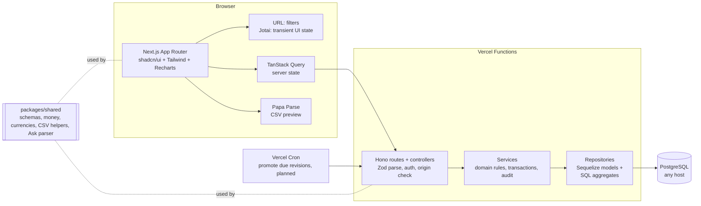
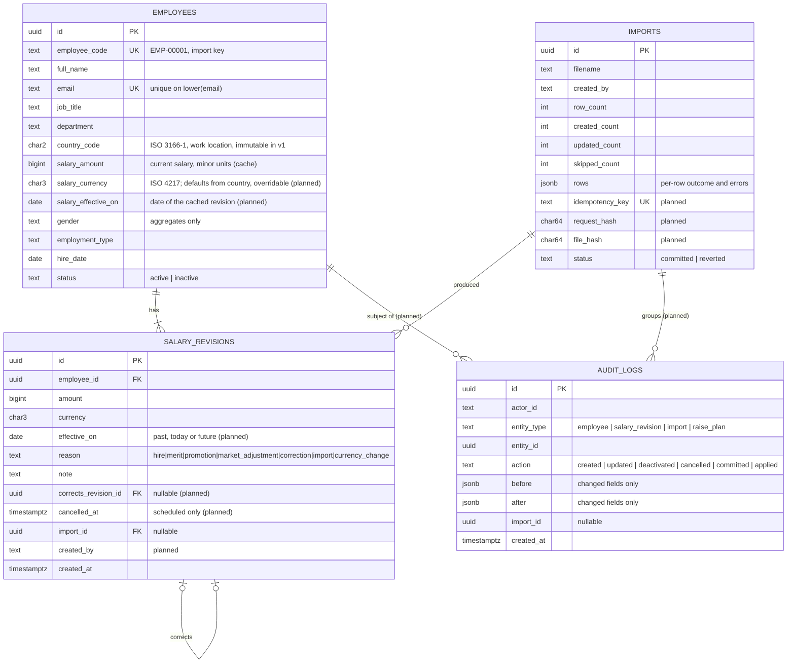

# Paywise: Design Notes

Scope and reasoning are in [`REQUIREMENTS.md`](REQUIREMENTS.md); the HTTP contract is in [`API.md`](API.md); security in [`SECURITY.md`](SECURITY.md). This document covers _how_ it is built.

**Status markers:** items marked **(planned)** are revision 2 work (`PLAN.md` §5); everything else is in the code today.

## 1. Architecture



- **Monorepo** (npm workspaces): `apps/api`, `apps/web`, `packages/shared`.
- **One source of truth for validation:** Zod schemas in `shared` are used by both the web forms and the API.
- **Layering:** routes declare paths; controllers handle only HTTP concerns (validate, call a service, shape the response); services own the business rules, transactions and audit entries; repositories own SQL. Folders follow the Outbox backend starter: `routes/<feature>/`, `controllers/<feature>/`, `services/<feature>/` (`-service.ts` and `-repository.ts`), plus `middlewares/`, `validators/`, `interfaces/`, `config/` and `models/`. Repositories receive the database handle, so tests inject an in-process Postgres (PGlite).
- **Data layer:** PostgreSQL through `pg` + **Sequelize**, as in the Outbox backends (no other ORM, no vendor driver): PascalCase models for CRUD and row locks, and `sequelize.query` with named replacements for every statistic and bulk write. The schema comes from the models via `npm run db:sync` (`sync({ alter: true })`) plus an idempotent `schema.sql` for what `sync()` can't express (`CHECK`s, partial and covering indexes, deferred composite FKs, the audit trigger). Any Postgres host works, configured by `DB_*` variables. `config/db.ts` gives every repository a `Db` handle (`{ sequelize, transaction? }`) and `select` / `execute` helpers, so a function runs the same inside or outside a transaction. `bigint` money arrives as an exact JS number (an `int8` type parser; every amount is far below 2⁵³). Details: `PLAN.md` §3.11.
- **Aggregates run in SQL** (`GROUP BY`, `percentile_cont`, `width_bucket`). The API never loads 10k rows into memory to compute statistics.
- **One origin for the browser:** the web app rewrites `/api/*` to the API deployment, so the signed session cookie is first-party: no CORS, and no third-party cookie blocking. `proxy.ts` (Next 16's middleware) only redirects visitors without a cookie to `/login`; the API verifies the session on every request.
- **State on the client:** TanStack Query owns everything fetched (keys per resource; every write invalidates employees, insights, fairness and filter options). Directory filters, sort and page live in the **URL**, so views can be shared and reloaded; a filter with several values repeats its key (`?country=IN&country=DE`), which the API reads as "any of", so commas inside values such as "VP, Sales" are safe. Jotai holds only transient UI state.
- **Deploy:** the API is bundled with esbuild into one Vercel Function (Hono's Vercel adapter); the web app is a standard Next.js project. Two projects vs one is weighed in `TRADEOFFS.md`; steps in `DEPLOY.md`.

## 2. Data Model



`login_attempts (key, window_start, failures)` (planned) backs the login rate limit and has no relations.

**Why `salary_amount` sits on `employees` as well as in revisions:** listing, sorting and aggregating read one table without a "latest revision" subquery. It is a **cache of the current revision**, written only by the salary-revision service (and import, raise plans and due-revision promotion, which go through the same repository functions), always in a transaction.

### 2.1 Salary timeline rules (each covered by a test)

Built today: rules 1, 3 and the "not before the latest revision" part of 5; revisions are append-only; one transaction with a row lock. Revision 2 (planned) generalises them to scheduled revisions and corrections:

1. A salary changes only by inserting a revision, inside the salary-revision service, in one transaction holding `SELECT … FOR UPDATE` on the employee.
2. Revisions are append-only. Only a **scheduled** revision can be cancelled (`cancelled_at`), because it hasn't happened yet; cancelling is audited.
3. `effective_on` ≥ hire date. Creating an employee writes a `hire` revision on the hire date.
4. One original (non-correction) revision per employee per date: partial unique index `(employee_id, effective_on) WHERE corrects_revision_id IS NULL AND cancelled_at IS NULL`, checked first in the service (`409 revision_date_taken`).
5. A new original revision can't be dated before the **current** one (that rewrites paid history); it may be dated before a scheduled one.
6. A correction uses the corrected revision's date and points to it (`corrects_revision_id`, unique). On a date, the latest-recorded revision wins, which is always the newest correction.
7. **Current** = the last revision on the timeline with `effective_on ≤ today`; **historical** = earlier; **scheduled** = later. The cache on `employees` always holds the current revision.
8. Writes that affect the current revision update the cache in the same transaction; scheduled revisions don't touch it.
9. `promoteDueRevisions(today)`: one idempotent `UPDATE … FROM` that moves the cache to the latest due revision, run by Vercel Cron daily at 00:10 UTC, on API cold start, and after each write. A test asserts cache = derived current for every employee in every scenario.
10. Deactivation cancels scheduled revisions in the same transaction.
11. Bulk writes (raise plans, imports) lock employees in id order, so two bulk writes can't deadlock.
12. Gender appears only in aggregates; a group with fewer than 5 of either gender is suppressed.

`previousAmount` in the API is derived at read time (`LAG` over the effective timeline), so a correction to an earlier revision can't leave a stale "previous" value on a later one.

### 2.2 Country and currency (planned)

- `country_code` (ISO 3166-1 alpha-2) is the work location; `salary_currency` (ISO 4217) is the pay currency.
- The currency defaults from the country; HR can pick another **supported** currency (shared list with exponents). A change on an existing employee is a revision with reason `currency_change` (amount and currency move together).
- Every aggregate groups by currency; a country with two pay currencies yields two rows. Fairness peer groups are country × job title × currency.
- **Relocation** (changing `country_code`) is a v2 workflow: one transaction for the country change plus an optional `currency_change` revision, audited.

## 3. Money

Stored like Stripe: an **integer amount in the smallest currency unit** plus a lowercase ISO 4217 code.

| Display       | Stored                                                  |
| ------------- | ------------------------------------------------------- |
| $85,000.00    | `{ amount: 8500000, currency: "usd" }`                  |
| ₹18,00,000.00 | `{ amount: 180000000, currency: "inr" }`                |
| ¥9,000,000    | `{ amount: 9000000, currency: "jpy" }` (zero-decimal)   |
| BD 12,000.500 | `{ amount: 12000500, currency: "bhd" }` (three-decimal) |

- `packages/shared/src/money.ts` is the only module that converts between user input, minor units and display.
- Input is parsed **as a string**, never `parseFloat(x) * 100`, so no binary floating-point error. Raises round half up to a whole minor unit (`applyRaise`, mirrored in SQL).
- `bigint` in Postgres, `number` in TypeScript; the largest plausible salary in minor units is far below `Number.MAX_SAFE_INTEGER`.
- **Amounts in different currencies are never added together** (no conversion policy exists; see TRADEOFFS).

## 4. Key Flows

### Change salary (with scheduling, planned)

```mermaid
sequenceDiagram
  participant UI
  participant API
  participant DB
  UI->>API: POST /employees/:id/salary-revisions {amount, effectiveOn, reason, correctsRevisionId?}
  API->>DB: BEGIN; SELECT employee FOR UPDATE
  API->>API: authorize; rules 3–6 (hire date, date taken, backdating, correction target)
  API->>DB: INSERT revision
  alt effectiveOn ≤ today
    API->>DB: UPDATE employees cache (amount, currency, effective_on)
  else scheduled
    API->>API: cache unchanged
  end
  API->>DB: INSERT audit_logs; COMMIT
  API-->>UI: 201 revision {state}
  Note over API,DB: Daily 00:10 UTC (and cold start): promoteDueRevisions(today)
```

### CSV import (with idempotency, planned)

```mermaid
sequenceDiagram
  participant UI
  participant API
  participant DB
  UI->>UI: Papa Parse, auto-map headers, user adjusts mapping
  UI->>API: POST /imports/preview {filename, mapping, rows}
  API->>DB: load existing codes and emails once (set lookup); file hash seen before?
  API-->>UI: per row create | update(diff) | unchanged | error; "already imported" warning
  UI->>UI: user reviews ("N valid rows will be saved · M will not"), downloads errors, confirms
  UI->>API: POST /imports + Idempotency-Key
  API->>DB: key exists? same hash → return original result; different → 409
  API->>API: re-validate everything (never trust the preview)
  API->>DB: BEGIN; lock employees in id order; insert import (with key); upsert employees; insert revisions (reason=import); insert audit; COMMIT
  API-->>UI: {created, updated, unchanged, skipped}
  Note over API,DB: Any error → ROLLBACK (no import, no key): "Nothing was saved", retry allowed
```

- **Matching key:** `employee_code` (emails change; codes don't). Duplicate codes or emails within the file, and emails owned by another employee, are row errors.
- **Invalid rows are never silently dropped:** they're listed, counted on the confirm button, downloadable, and stored on the import record (line, code, messages; no raw values).
- **Limit:** 10,000 rows per file (Vercel's 4.5 MB request limit).
- **Optional columns:** `gender` (updates keep the stored value; creates default to `undisclosed`) and `currency` (planned; blank = country default). This is what lets an export be edited and imported back.

### Export

UTF-8 **with BOM** (so Excel shows non-ASCII names correctly), and formula-injection safe: cells starting with `=`, `+`, `-`, `@`, tab or CR are prefixed with `'` (OWASP).

## 5. Analytics Definitions

| Metric                               | Definition                                                                                                                                                                                                                                                                                                                                                                                                                                                     |
| ------------------------------------ | -------------------------------------------------------------------------------------------------------------------------------------------------------------------------------------------------------------------------------------------------------------------------------------------------------------------------------------------------------------------------------------------------------------------------------------------------------------- |
| Median / quartiles                   | `percentile_cont`, which equals Excel `PERCENTILE.INC` (linear interpolation)                                                                                                                                                                                                                                                                                                                                                                                  |
| Salary outlier                       | Active, full-time employees in a country × job title (× currency) group with n ≥ 5: below Q1 − 1.5·IQR or above Q3 + 1.5·IQR. When IQR = 0 nobody is an outlier                                                                                                                                                                                                                                                                                                |
| Gender-based compensation difference | Active, full-time employees per country × job title (× currency): `(mean_men − mean_women) / mean_men`, with the median difference alongside. `null` ("not comparable") when either gender is absent or `mean_men` is 0. **Suppressed** (no averages at all) when women or men number fewer than `FAIRNESS_MIN_GROUP` (default 5)                                                                                                                              |
| Potential pay disparity              | \|difference\| ≥ `FAIRNESS_GAP_THRESHOLD` (default 5%). An **analytical flag** chosen to match a common reporting convention, **not a legal standard**, and configurable (planned; hard-coded at 5% today)                                                                                                                                                                                                                                                     |
| "Less likely to be chance"           | Welch t-test with \|t\| ≥ 1.96 (~95%). With ~150 groups, some flags are still chance                                                                                                                                                                                                                                                                                                                                                                           |
| Raise cost                           | Per currency over the plan: active employees matching the filters (any of the chosen values within a filter, every filter together; when the group raise is above 0%) plus anyone given an individual raise, which replaces the group raise for them. Current total, increase (each person's raise rounded half up to a minor unit), new total. Applying writes a revision per changed person in one transaction; a future date makes them scheduled (planned) |

Only **active** employees count in insights. Every figure shows its sample size.

**Wording rule:** the UI and docs say "salary outliers", "gender-based compensation differences" and "potential pay disparity", and carry this disclaimer: _these are statistical indicators; differences can reflect tenure, level, performance or location within a country, which Paywise doesn't record; they are not evidence of discrimination or of legal non-compliance._ (Planned: today's UI still says "Review: gap ≥ 5%" and cites the EU Directive.)

**Why full-time only:** part-time pay reflects hours, which we don't record. Mixing it in made "differences" appear wherever one gender had more part-timers.

**Why a confidence marker:** on the seeded 10k data, a plain 5% rule flagged 95 of ~150 groups, almost all noise from small teams, and the planted difference was buried. The marker ranks what to look at first.

## 6. Audit Logging (planned)

- `audit_logs` is separate from salary history: history answers "what was the salary on a date"; the audit log answers "who did what, when".
- Services call `AuditService.record(tx, entries)` **inside the same transaction** as the change, with the actor passed down from the controller. If the audit insert fails, the change rolls back.
- Entries hold identifiers, the action and changed fields only. Salary amounts aren't copied (entries reference the revision id); gender changes are recorded without values.
- A trigger rejects `UPDATE` and `DELETE` on `audit_logs`; production's database role has `INSERT, SELECT` only. Tests use `TRUNCATE` between cases, which the trigger doesn't block.
- Imports write one summary entry plus per-employee entries carrying `import_id`, batched like the revisions.

## 7. Ask Paywise (planned, P1)

A **controlled** query engine: text → deterministic parser (in `shared`) → `QueryPlan` validated by Zod → one of five predefined, parameterised repository queries → typed result (`kpi`, `table` or `chart`).

- Vocabulary comes from `/meta/filters` (countries with aliases, departments, job titles with simple synonyms such as "engineers").
- Intents: `metric` (average, median, total payroll, count, min, max), `top_group`, `count_threshold`, `compare_distribution`, plus filters (country, department, job title).
- No text reaches SQL; only enum values and bound parameters. No LLM in v1.
- Thresholds need a single currency; cross-country answers stay per currency; individual-level questions are unsupported by design, and every unsupported answer explains why with example questions.

## 8. Transactions and Concurrency

| Operation                             | One transaction containing                                   | Locks                     |
| ------------------------------------- | ------------------------------------------------------------ | ------------------------- |
| Create employee                       | employee, `hire` revision, audit                             | unique indexes            |
| Update / deactivate                   | employee, cancelled scheduled revisions, audit               | employee row              |
| Salary revision / correction / cancel | revision, cache (if current), audit                          | employee row `FOR UPDATE` |
| Apply raise plan                      | every revision, caches, audit                                | employees in id order     |
| Import commit                         | import record + idempotency key, employees, revisions, audit | employees in id order     |
| Promote due revisions                 | cache updates only (idempotent)                              | rows updated              |

Reads (lists, analytics, Ask) run without explicit transactions. PGlite tests cover each rule; one test runs two salary writes for the same employee concurrently and checks that one waits for the other.

## 9. Testing Approach

- **Pure logic** (money, currencies, CSV helpers, schemas, seed generator, Ask parser): plain Vitest, written test-first.
- **Services and SQL**: Vitest against **PGlite** (real Postgres in-process; with Sequelize it is reached over `@electric-sql/pglite-socket`). Each file gets a freshly created DB; tables are truncated between tests. Fixtures are a handful of hand-computed employees, never the 10k seed.
- **Routes**: Hono's `app.request()`, with no network.
- **UI**: React Testing Library + MSW (planned beyond today's helper tests); a local Playwright walkthrough checks every page.
- No clock or randomness leaks: fixed seed, injected "today".
