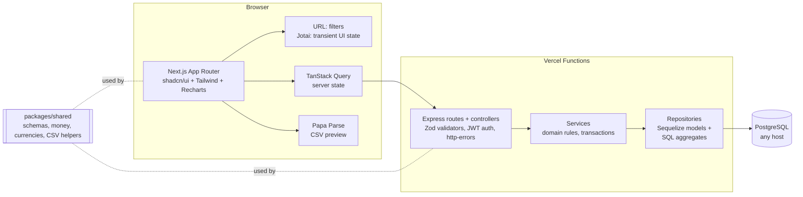
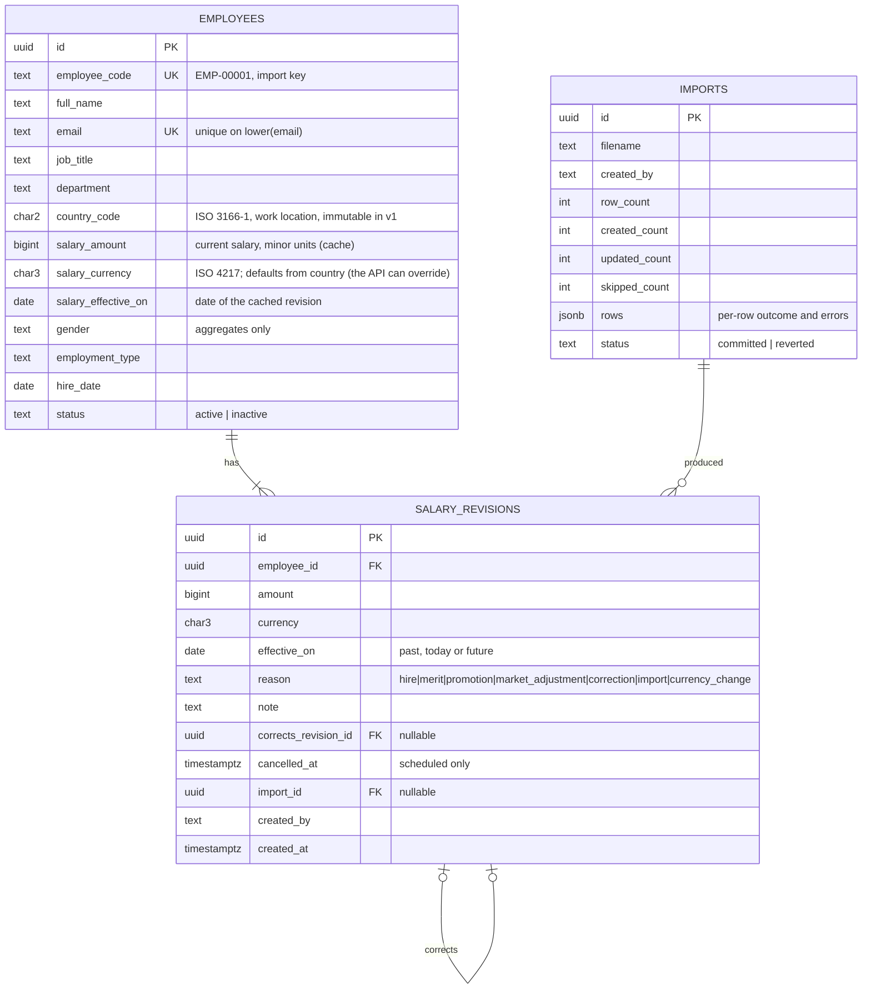

# Paywise: Design Notes

Scope and reasoning are in [`REQUIREMENTS.md`](REQUIREMENTS.md); the HTTP contract is in [`API.md`](API.md); security in [`SECURITY.md`](SECURITY.md). This document covers _how_ it is built.

Everything described here is in the code today; what was left out is listed in `REQUIREMENTS.md`.

## 1. Architecture



- **Monorepo** (npm workspaces): `apps/api`, `apps/web`, `packages/shared`.
- **One source of truth for validation:** Zod schemas in `shared` are used by both the web forms and the API.
- **Layering:** routes declare paths; controllers handle only HTTP concerns (validate, call a service, shape the response); services own the business rules and transactions; repositories own SQL. Folders follow the Outbox backend starter: `routes/<feature>/`, `controllers/<feature>/`, `services/<feature>/` (`-service.ts` and `-repository.ts`), plus `middlewares/`, `validators/`, `interfaces/`, `config/` and `models/`. Repositories receive the database handle, so tests inject an in-process Postgres (PGlite).
- **Data layer:** PostgreSQL through `pg` + **Sequelize**, as in the Outbox backends (no other ORM, no vendor driver): PascalCase models for CRUD and row locks, and `sequelize.query` with named replacements for every statistic and bulk write. The schema comes from the models via `npm run db:sync` (`sync({ alter: true })`) plus an idempotent `schema.sql` for what `sync()` can't express (`CHECK`s, partial and covering indexes, deferred composite FKs). Any Postgres host works, configured by `DB_*` variables. `config/db.ts` gives every repository a `Db` handle (`{ sequelize, transaction? }`) and `select` / `execute` helpers, so a function runs the same inside or outside a transaction. `bigint` money arrives as an exact JS number (an `int8` type parser; every amount is far below 2⁵³). Details: `PLAN.md` §3.11.
- **Aggregates run in SQL** (`GROUP BY`, `percentile_cont`, `width_bucket`). The API never loads 10k rows into memory to compute statistics.
- **HTTP layer:** Express 4, as in our other backends. Each route lists its middlewares: `verifyAccessToken`, then a validator that runs the shared Zod schema and replaces `req.body` / `req.query` with the parsed value, then the controller, wrapped in `asyncHandler` so rejected promises reach the central error handler. Errors are `http-errors` with a stable `code` (and field `details`), serialised as `{ error: { code, message, details } }`; unexpected errors become a generic 500.
- **Auth:** `POST /api/auth/login` returns a signed JWT (8 hours). The web app keeps it in an `auth_token` cookie (js-cookie, expiring with the token) and its axios client sends `Authorization: Bearer` on every call. `proxy.ts` (Next 16's middleware) redirects signed-out or expired visitors to `/login?next=…` on the server, before any page renders; a 401 from the API clears the cookie and does the same. The API never reads cookies, so the cookie can't be used for CSRF. By default the web app still rewrites `/api/*` to the API, so the browser talks to one origin.
- **State on the client:** TanStack Query owns everything fetched (keys per resource; every write invalidates employees, insights, fairness and filter options). Directory filters, sort and page live in the **URL**, so views can be shared and reloaded; a filter with several values repeats its key (`?country=IN&country=DE`), which the API reads as "any of", so commas inside values such as "VP, Sales" are safe. Jotai holds only transient UI state.
- **Deploy:** the API ships as one prebuilt Vercel function (`apps/api/server.ts` exports the Express app; esbuild bundles it, `@paywise/shared` included, into Vercel's Build Output format); the web app is a standard Next.js project. Two projects vs one is weighed in `TRADEOFFS.md`; steps in `DEPLOY.md`.

## 2. Data Model



**Why `salary_amount` sits on `employees` as well as in revisions:** listing, sorting and aggregating read one table without a "latest revision" subquery. It is a **cache of the current revision**, written only by the salary-revision service (and import, raise plans and due-revision promotion, which go through the same repository functions), always in a transaction.

### 2.1 Salary timeline rules (each covered by a test)

1. A salary changes only by inserting a revision, inside the salary-revision service, in one transaction holding `SELECT … FOR UPDATE` on the employee.
2. Revisions are append-only. Only a **scheduled** revision can be cancelled (`cancelled_at`), because it hasn't happened yet; deactivating an employee cancels theirs. The one edit is moving the `hire` revision when the hire date is corrected.
3. `effective_on` ≥ hire date. Creating an employee writes a `hire` revision on the hire date.
4. One original (non-correction) revision per employee per date: partial unique index `(employee_id, effective_on) WHERE corrects_revision_id IS NULL AND cancelled_at IS NULL`, checked first in the service (`409 revision_date_taken`).
5. A new original revision can't be dated before the **current** one (that rewrites paid history); it may be dated before a scheduled one.
6. A correction uses the corrected revision's date and points to it (`corrects_revision_id`, unique). On a date, the latest-recorded revision wins, which is always the newest correction.
7. **Current** = the last revision on the timeline with `effective_on ≤ today`; **historical** = earlier; **scheduled** = later. The cache on `employees` always holds the current revision.
8. Writes that affect the current revision update the cache in the same transaction; scheduled revisions don't touch it.
9. `promoteDueRevisions(today)` moves every stale cache to its current revision: it locks the stale rows in id order, then updates them in a later statement, so a correction committed meanwhile isn't overwritten. It is idempotent and runs on the first API request of each day (no cron job); tests cover promotion on the date, the once-a-day middleware and the directory showing the new salary.
10. Deactivation cancels scheduled revisions in the same transaction.
11. Bulk writes (raise plans, imports) lock employees in id order, so two bulk writes can't deadlock.
12. Gender appears only in aggregates; a group with fewer than 5 of either gender is suppressed.

`previousAmount` in the API is derived at read time (`LAG` over the effective timeline), so a correction to an earlier revision can't leave a stale "previous" value on a later one.

### 2.2 Country and currency

- `country_code` (ISO 3166-1 alpha-2) is the work location; `salary_currency` (ISO 4217) is the pay currency.
- The currency defaults from the country. The API can set another **supported** currency (shared list with exponents) when creating an employee, and a later change is a revision with reason `currency_change` (amount and currency move together). The web app's forms and CSV import always use the country default.
- Country summaries and gender comparisons group by currency, so a country with two pay currencies yields two rows. Job-title, department, distribution and outlier figures assume one pay currency per country, which holds for everything the app itself creates.
- **Relocation** (changing `country_code`) is a v2 workflow: one transaction for the country change plus an optional `currency_change` revision.

## 3. Money

Stored like Stripe: an **integer amount in the smallest currency unit** plus a lowercase ISO 4217 code.

| Display       | Stored                                                  |
| ------------- | ------------------------------------------------------- |
| $85,000.00    | `{ amount: 8500000, currency: "usd" }`                  |
| ₹18,00,000.00 | `{ amount: 180000000, currency: "inr" }`                |
| ¥9,000,000    | `{ amount: 9000000, currency: "jpy" }` (zero-decimal)   |
| BD 12,000.500 | `{ amount: 12000500, currency: "bhd" }` (three-decimal) |

- `packages/shared/src/money.ts` is the only module that converts between user input, minor units and display.
- Input is parsed **as a string**, never `parseFloat(x) * 100`, so no binary floating-point error. Raises round half up to a whole minor unit (`applyRaise`, mirrored in SQL).
- `bigint` in Postgres, `number` in TypeScript; the largest plausible salary in minor units is far below `Number.MAX_SAFE_INTEGER`.
- **Amounts in different currencies are never added together** (no conversion policy exists; see TRADEOFFS).

## 4. Key Flows

### Change salary (with scheduling)

```mermaid
sequenceDiagram
  participant UI
  participant API
  participant DB
  UI->>API: POST /employees/:id/salary-revisions {amount, effectiveOn, reason, correctsRevisionId?}
  API->>DB: BEGIN; SELECT employee FOR UPDATE
  API->>API: rules 3–6 (hire date, date taken, backdating, correction target)
  API->>DB: INSERT revision
  alt effectiveOn ≤ today
    API->>DB: UPDATE employees cache (amount, currency, effective_on)
  else scheduled
    API->>API: cache unchanged
  end
  API->>DB: COMMIT
  API-->>UI: 201 employee with revisions {state}
  Note over API,DB: First request of each day: promoteDueRevisions(today)
```

### CSV import

```mermaid
sequenceDiagram
  participant UI
  participant API
  participant DB
  UI->>UI: Papa Parse, auto-map headers, user adjusts mapping
  UI->>API: POST /imports/preview {filename, mapping, rows}
  API->>DB: load existing codes and emails once (set lookup)
  API-->>UI: per row create | update(diff) | unchanged | error
  UI->>UI: user reviews ("N valid rows will be saved · M will not"), downloads errors, confirms
  UI->>API: POST /imports (button disabled while it runs)
  API->>API: re-validate everything (never trust the preview)
  API->>DB: BEGIN; lock employees in id order; insert import; upsert employees; insert revisions (reason=import); COMMIT
  API-->>UI: {created, updated, unchanged, skipped}
  Note over API,DB: Any error → ROLLBACK: "Nothing was saved", retry allowed
```

- **Matching key:** `employee_code` (emails change; codes don't). Duplicate codes or emails within the file, and emails owned by another employee, are row errors.
- **Invalid rows are never silently dropped:** they're listed, counted on the confirm button, downloadable, and stored on the import record (line, code, messages; no raw values).
- **Limit:** 10,000 rows per file (Vercel's 4.5 MB request limit).
- **Optional columns:** `gender` (updates keep the stored value; creates default to `undisclosed`) . This is what lets an export be edited and imported back.

### Export

UTF-8 **with BOM** (so Excel shows non-ASCII names correctly), and formula-injection safe: cells starting with `=`, `+`, `-`, `@`, tab or CR are prefixed with `'` (OWASP).

## 5. Analytics Definitions

| Metric                               | Definition                                                                                                                                                                                                                                                                                                                                                                                                                                           |
| ------------------------------------ | ---------------------------------------------------------------------------------------------------------------------------------------------------------------------------------------------------------------------------------------------------------------------------------------------------------------------------------------------------------------------------------------------------------------------------------------------------- |
| Median / quartiles                   | `percentile_cont`, which equals Excel `PERCENTILE.INC` (linear interpolation)                                                                                                                                                                                                                                                                                                                                                                        |
| Salary outlier                       | Active, full-time employees in a country × job title (× currency) group with n ≥ 5: below Q1 − 1.5·IQR or above Q3 + 1.5·IQR. When IQR = 0 nobody is an outlier                                                                                                                                                                                                                                                                                      |
| Gender-based compensation difference | Active, full-time employees per country × job title (× currency): `(mean_men − mean_women) / mean_men`, with the median difference alongside. `null` ("not comparable") when either gender is absent or `mean_men` is 0. **Suppressed** (no averages at all) when women or men number fewer than `FAIRNESS_MIN_GROUP` (default 5)                                                                                                                    |
| Potential pay disparity              | \|difference\| ≥ 5%. An **analytical flag** chosen to match a common reporting convention, **not a legal standard**, fixed at 5%                                                                                                                                                                                                                                                                                                                     |
| "Less likely to be chance"           | Welch t-test with \|t\| ≥ 1.96 (~95%). With ~150 groups, some flags are still chance                                                                                                                                                                                                                                                                                                                                                                 |
| Raise cost                           | Per currency over the plan: active employees matching the filters (any of the chosen values within a filter, every filter together; when the group raise is above 0%) plus anyone given an individual raise, which replaces the group raise for them. Current total, increase (each person's raise rounded half up to a minor unit), new total. Applying writes a revision per changed person in one transaction; a future date makes them scheduled |

Only **active** employees count in insights. Every figure shows its sample size.

**Wording rule:** the UI and docs say "salary outliers", "gender-based compensation differences" and "potential pay disparity", and carry this disclaimer: _these are statistical indicators; differences can reflect tenure, level, performance or location within a country, which Paywise doesn't record; they are not evidence of discrimination or of legal non-compliance._

**Why full-time only:** part-time pay reflects hours, which we don't record. Mixing it in made "differences" appear wherever one gender had more part-timers.

**Why a confidence marker:** on the seeded 10k data, a plain 5% rule flagged 95 of ~150 groups, almost all noise from small teams, and the planted difference was buried. The marker ranks what to look at first.

## 6. Transactions and Concurrency

| Operation                    | One transaction containing              | Locks                     |
| ---------------------------- | --------------------------------------- | ------------------------- |
| Create employee              | employee, `hire` revision               | unique indexes            |
| Update / deactivate          | employee, cancelled scheduled revisions | employee row              |
| Salary revision / correction | revision, cache (if current)            | employee row `FOR UPDATE` |
| Apply raise plan             | every revision, caches                  | employees in id order     |
| Import commit                | import record, employees, revisions     | employees in id order     |
| Promote due revisions        | cache updates only (idempotent)         | stale rows, in id order   |

Reads (lists, analytics) run without explicit transactions. PGlite tests cover each rule. PGlite has a single connection, so races run in `test/concurrency.pg.test.ts` against real Postgres when `TEST_PG_URL` is set (always in CI): two people changing the same salary at once (one wins, the other gets `409 stale_salary`), and four overlapping raise plans locking the same 200 people at once (all complete; with the id lock order replaced by a random one, the test fails on a deadlock).

## 7. How the Non-Obvious Parts Work

The code carries no comments (CLAUDE.md), so the reasoning behind the parts that aren't obvious from reading lives here.

**API**

- **Two shadcn/ui components are modified.** `components/ui/table.tsx` takes `containerClassName`/`containerRef`, so a table can be its own scroll container (max height plus overflow) and keep a sticky header; every header is a grey band with bold labels. `components/ui/tabs.tsx` draws the switcher as a white track with the same corner radius as buttons and inputs, and the active tab solid black (lime in dark mode) with a lime icon. `components/ui/skeleton.tsx` is a faint block that fades in after a short delay and pulses slowly (the stock high-contrast shine flashed on quick loads); reduced-motion users get the static block at once.
- **The current-salary cache** (`employees.salary_amount`, `salary_currency`, `salary_effective_on`, `current_revision_id`) is a copy of one revision, kept so lists and statistics read one table. A composite foreign key pins it to a real revision of the same employee. `refreshSalaryCache` (`salary-revisions-repository.ts`) rewrites the copy whenever any copied field differs, not only the revision id: moving a hire date keeps the id but changes the date.
- **Scheduled changes take effect without a cron job.** `promoteDueRevisionsDaily` (`middlewares/promote-due.ts`) runs `promoteDueRevisions` on the first API request of each day, per server instance. Simultaneous requests share one run, a failure is retried on the next request, and the update is idempotent, so several instances running it is harmless. It locks the stale rows first and updates them in a second statement, so a correction committed meanwhile isn't overwritten (SCHEMA_REVIEW F2).
- **Two people changing one salary.** Each change locks the employee row; the request carries `basedOnRevisionId` (the latest change the user saw), and a mismatch is `409 stale_salary` instead of building on a value nobody saw (F1). Raise plans and imports lock many employees in id order, so they can't deadlock (F3). Both races are tested on real Postgres.
- **Corrections** use the corrected change's date and point at it; only the newest entry on a date can be corrected, and the latest-recorded entry on a date wins. `previousAmount` is derived at read time with `LAG`, so a correction never leaves a stale "previous" value behind.
- **Import** plans every row (`imports-plan.ts`: validate, match by code, check emails and hire dates, diff), shows that as the preview, then plans again inside the commit transaction with the rows locked: the preview is never trusted. Updates are one `UPDATE … FROM jsonb_to_recordset` per 1,000 rows.
- **Typed requests.** Validator middleware parses body and query with the shared Zod schemas and replaces them; controllers declare the parsed types through `ValidatedRequest`, and the only cast is in `asyncHandler`.

**Web**

- **Sign-in and sign-out are full page loads.** Next.js 16 keeps visited pages alive and shows them again with their old state, so a client-side switch would restore a filled-in sign-in form, play two splash screens, and keep salaries in memory after sign-out. `proxy.ts` redirects signed-out or expired visitors on the server, before any page renders.
- **The import wizard starts fresh on every visit.** For the same reason, a page left mid-import would come back at step 3, and a Jotai atom changed while the page is hidden isn't re-read. `ImportWizard` resets the atom and remounts the wizard with a new `key` on each arrival, before paint; a request that finishes after you left is ignored (`onPage` in `useImportWizard`).
- **Quick filter picks.** The directory's filters live in the URL, which updates a moment after a click. `FilterBar` builds each pick on its own local selection (resynced from the URL only when the selection's content changes), and `useDirectoryQuery` merges each change into the latest pending one, so clicking India then Germany quickly keeps both.
- **Downloads** fetch the file with the Bearer token and save the blob (`downloadFile`): a plain link can't send the header.
- **The virtualized directory** scrolls through the virtualizer (`scrollToOffset`), not the container: the virtualizer adjusts the scroll position as it measures rows, which cuts a native smooth scroll short.

## 8. Testing Approach

- **Pure logic** (money, currencies, CSV helpers, schemas, seed generator): plain Vitest, written test-first.
- **Services and SQL**: Vitest against **PGlite** (real Postgres in-process; with Sequelize it is reached over `@electric-sql/pglite-socket`). Each file gets a freshly created DB; tables are truncated between tests. Fixtures are a handful of hand-computed employees, never the 10k seed.
- **Routes**: the Express app served on a random loopback port (`test/http.ts`) and called with `fetch`, so tests assert on real status codes, headers and bytes; nothing leaves the machine.
- **UI**: unit tests for the CSV helpers; every page and flow was checked end to end in a headless browser against a seeded database. There are no component tests yet.
- No clock or randomness leaks: fixed seed, injected "today".
