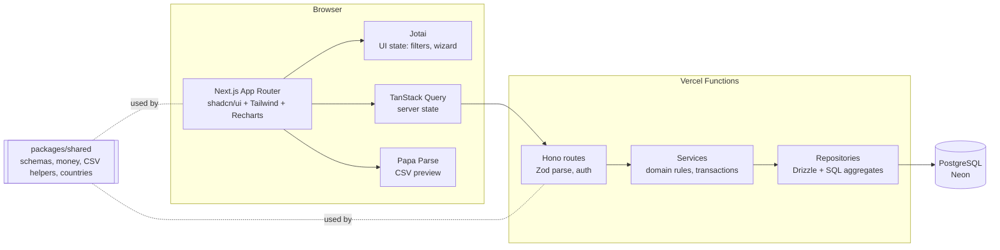
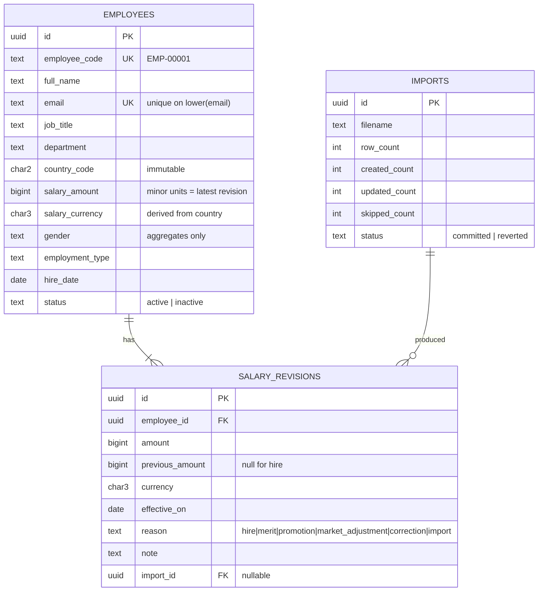

# Paywise: Design Notes

Scope and reasoning are in [`REQUIREMENTS.md`](REQUIREMENTS.md). This document covers _how_ it is built.

## 1. Architecture



- **Monorepo** (npm workspaces): `apps/api`, `apps/web`, `packages/shared`.
- **One source of truth for validation:** Zod schemas in `shared` are used by both the web forms and the API.
- **Layering:** routes handle only HTTP concerns; services own the business rules and transactions; repositories own SQL. Repositories receive a `db` handle, so tests inject an in-process Postgres (PGlite).
- **Aggregates run in SQL** (`GROUP BY`, `percentile_cont`, `width_bucket`). The API never loads 10k rows into memory to compute statistics.

## 2. Data Model



**Why `salary_amount` sits on `employees` as well as in revisions:** listing, sorting and aggregating read one table without a "latest revision" subquery. It is written **only** inside the same transaction that inserts a revision, so the two can't drift apart.

### Domain rules (each covered by a test)

1. Currency is derived from the country, never typed in.
2. `salary_amount` changes only by writing a revision, in the same transaction (with a row lock).
3. Revisions are append-only. Mistakes are fixed by a `correction` revision.
4. Creating an employee writes a `hire` revision.
5. A revision's `effective_on` is ≤ today, ≥ hire date, and ≥ the latest revision's date.
6. `country_code` is immutable after creation.
7. Gender appears only in aggregates; a group with fewer than 5 people of either gender is suppressed.

## 3. Money

Stored like Stripe: an **integer amount in the smallest currency unit** plus a lowercase ISO 4217 code.

| Display       | Stored                                                |
| ------------- | ----------------------------------------------------- |
| $85,000.00    | `{ amount: 8500000, currency: "usd" }`                |
| ₹18,00,000.00 | `{ amount: 180000000, currency: "inr" }`              |
| ¥9,000,000    | `{ amount: 9000000, currency: "jpy" }` (zero-decimal) |

- `packages/shared/src/money.ts` is the only module that converts between user input, minor units and display.
- Input is parsed **as a string**, never `parseFloat(x) * 100`, so no binary floating-point error.
- `bigint` in Postgres, `number` in TypeScript. The largest plausible annual salary in minor units (e.g. ₹10 crore = 10¹⁰ paise) is far below `Number.MAX_SAFE_INTEGER` (~9×10¹⁵).

## 4. Key Flows

### Change salary

```mermaid
sequenceDiagram
  participant UI
  participant API
  participant DB
  UI->>API: POST /employees/:id/salary-revisions {amount, effectiveOn, reason}
  API->>DB: BEGIN; SELECT ... FOR UPDATE
  API->>API: validate rules 2, 5
  API->>DB: INSERT revision; UPDATE employees.salary_amount; COMMIT
  API-->>UI: 201 revision
  UI->>UI: invalidate ['employee', id], ['employees'], ['insights']
```

### CSV import

```mermaid
sequenceDiagram
  participant UI
  participant API
  participant DB
  UI->>UI: Papa Parse file, auto-map headers, user adjusts mapping
  UI->>API: POST /imports/preview {filename, mapping, rows}
  API->>DB: load existing codes + emails once (set lookup)
  API-->>UI: per row: create | update(diff) | unchanged | error(row, column, message)
  UI->>UI: user reviews, downloads error CSV, confirms
  UI->>API: POST /imports (same body)
  API->>API: re-validate everything (never trust the preview)
  API->>DB: BEGIN; insert import; upsert employees; insert revisions(reason=import); COMMIT
  API-->>UI: {created, updated, skipped}
```

- **Matching key:** `employee_code` (emails change; codes don't).
- **Error rows are skipped**, but only after the user has seen them in the preview. Valid rows commit all-or-nothing.
- **Limit:** 10,000 rows per file (Vercel's 4.5 MB request limit).
- **Optional columns:** `gender` may be omitted. Updates keep the stored value; creates default to `undisclosed`. This is what lets an **export** (which never includes gender) be edited and imported back.

### Export

UTF-8 **with BOM** (so Excel shows non-ASCII names correctly), and formula-injection safe: cells starting with `=`, `+`, `-`, `@`, tab or CR are prefixed with `'` (OWASP).

## 5. Analytics Definitions

| Metric             | Definition                                                                                                                                            |
| ------------------ | ----------------------------------------------------------------------------------------------------------------------------------------------------- |
| Median / quartiles | `percentile_cont`, which equals Excel `PERCENTILE.INC` (linear interpolation)                                                                         |
| Outlier            | In a job title × country group with n ≥ 5: below Q1 − 1.5·IQR or above Q3 + 1.5·IQR                                                                   |
| Gender pay gap     | `(mean_male − mean_female) / mean_male` per job title × country; flagged at \|gap\| ≥ 5% (EU Pay Transparency Directive); the median gap is shown too |
| Raise cost         | Per currency over the filtered active employees: current total, increase, new total                                                                   |

Only **active** employees count in insights.

## 6. API Conventions

- REST + JSON; resources under `/api`.
- Errors: `{ "error": { "code": "validation_failed", "message": "...", "details": [...] } }`.
- Status codes: 400 bad query · 401 not signed in · 404 · 409 conflict/duplicate · 413 import too large · 422 validation.
- Pagination: `?page=1&pageSize=25` (max 100) → `{ data, page, pageSize, total }`.
- Sort columns are whitelisted, never interpolated.

## 7. Testing Approach

- **Pure logic** (money, CSV helpers, schemas, seed generator): plain Vitest, written test-first.
- **Services and SQL**: Vitest against **PGlite** (real Postgres in-process). Each file gets a freshly migrated DB; tables are truncated between tests. Fixtures are small and hand-computed.
- **Routes**: Hono's `app.request()`, with no network.
- **UI**: React Testing Library + MSW.
- No clock or randomness leaks: fixed seed, injected "today".
