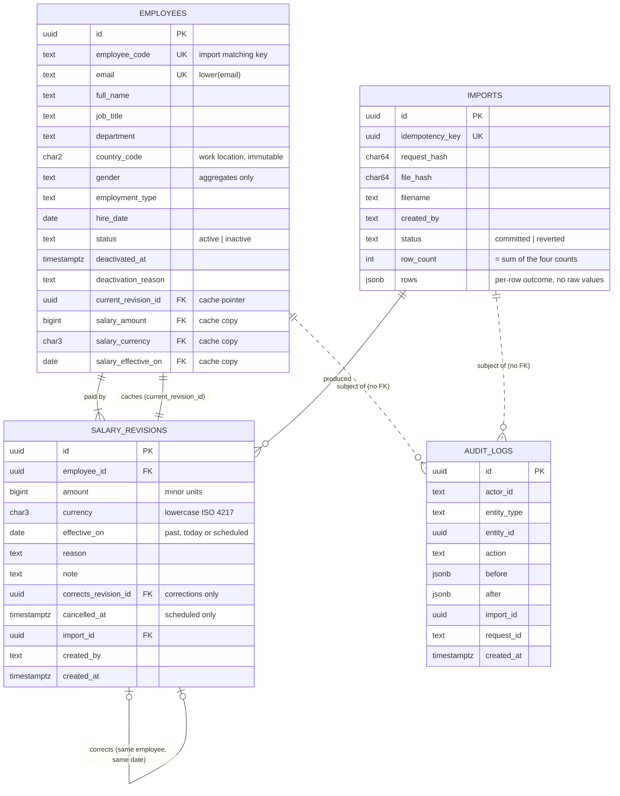

# Schema Review: salary data model

A senior-backend review of the salary data model: the **built** schema (`apps/api/src/models/`, migrations `0001`–`0002`) and the **planned** one (`PLAN.md` revision 2, §3.2–3.7). It covers concurrent HR writes, effective dates, currency, audit and import provenance, and ends with a concrete PostgreSQL schema.

**Status: proposal.** It builds on PLAN.md revision 2 and keeps all of its decisions, including the cached current salary, the correction chain, the currency override, `Idempotency-Key` and `audit_logs`. It adds the constraints and concurrency rules that the plan leaves implicit. Every claim marked _verified_ was run on PostgreSQL ([§10](#10-evidence)).

## 1. Verdict

PLAN.md revision 2 is a sound model: point-in-time revisions, a cache of the current one, scheduled revisions with promotion, same-date corrections as a chain, history kept separate from audit, and idempotent imports. Two problems remain:

- The built code is still on revision 1.
- The plan relies on the service to keep things consistent in places where the database could guarantee it, and three concurrent cases aren't handled. One of those is a new bug in the plan's promotion job.

| #   | Finding                                                                                                                                                                                                                                                                                                                                                    | Where            | Severity | Fix                                                                                     |
| --- | ---------------------------------------------------------------------------------------------------------------------------------------------------------------------------------------------------------------------------------------------------------------------------------------------------------------------------------------------------------- | ---------------- | -------- | --------------------------------------------------------------------------------------- |
| F1  | **Lost decision.** Two HR sessions open an employee at 100. A saves 110, then B saves 120. The row lock serialises them, but B's raise lands on a salary B never saw. _Verified:_ history `100 → 110 → 120`, both 201.                                                                                                                                     | built + plan     | High     | The client sends `basedOnRevisionId`; 409 `stale_salary` if it isn't the latest (§5)    |
| F2  | **The promotion job can undo a correction.** The plan's set-based `UPDATE … FROM (latest due revision)` takes its snapshot before it waits for a row lock. If HR corrects a revision that is becoming due at that moment, the job overwrites the correction in the cache with the corrected-away revision. _Verified:_ cache 150, correct 140.             | plan §3.3 rule 8 | High     | Lock the candidates first (`ORDER BY id`), then update in a **new statement** (§5)      |
| F3  | **Deadlocks.** `lockRaisePlan` and the import's `FOR UPDATE` lock rows in no fixed order (the plan says id order; the code doesn't do it yet). `40P01` and `23505` from races then reach the user as 500, because `changeSalary`, `deactivate` and `applyRaises` don't use `mapDbError`. _Verified:_ `40P01` with opposite order, none with `ORDER BY id`. | built            | Medium   | `ORDER BY id` on every multi-row lock; map `40P01` and race `23505`s to 409 "try again" |
| F4  | **The cache is only as good as the code that writes it.** Nothing in the database stops `salary_amount` from holding an amount that is no revision at all.                                                                                                                                                                                                 | built + plan     | Medium   | `current_revision_id` plus a composite FK onto the revision it copies (§2.3)            |
| F5  | **Correction rules live only in the service.** Nothing stops a correction from targeting another employee's revision or a different date.                                                                                                                                                                                                                  | plan             | Medium   | A composite self-FK `(corrects_revision_id, employee_id, effective_on)`                 |
| F6  | **History can be deleted.** `salary_revisions.employee_id … ON DELETE CASCADE`.                                                                                                                                                                                                                                                                            | built            | Medium   | `ON DELETE RESTRICT` (also on `import_id`)                                              |
| F7  | **Free-text enums.** No `CHECK` on `gender`, `status`, `employment_type`, `reason` or currency format, and no amount ceiling to catch unit mistakes.                                                                                                                                                                                                       | built + plan     | Low      | `CHECK`s (§4)                                                                           |
| F8  | **Same-date ties ordered by `created_at`.** That's safe only because the plan's partial unique index allows one original per date. The built code has no such index, so two same-day revisions are ordered by transaction **start** time (`now()`), which may not match commit order.                                                                      | built            | Low      | Add the plan's partial unique index first (step 1 in §9)                                |
| F9  | **A concurrent double submit of an import** blocks on the `idempotency_key` index, then fails with `23505`. The plan describes a replay only for the sequential case. _Verified._                                                                                                                                                                          | plan §3.5        | Low      | Catch `23505` on that index, roll back, then read and replay the first result           |
| F10 | `employees_status_idx` (two values, mostly `active`) is never used for `status = 'active'`. Revision reads aren't index-only.                                                                                                                                                                                                                              | built + plan     | Low      | Drop it; use the partial covering timeline index (§4)                                   |

## 2. Design decisions

1. **Employee vs compensation.** `employees` holds who the person is and where they work, plus a **cache** of their current pay. `salary_revisions` is the source of truth for pay over time. Nothing else on `employees` is compensation.
2. **Effective dates.** A revision is a point in time: "from `effective_on`, pay is `amount` in `currency`". Its end is the next revision's date, derived with `lead()`, never stored. So rows can't overlap, and inserting one never requires closing another. On a date _d_ (the organisation's date, UTC, as in PLAN.md):
   - **historical**: the next revision starts on or before _d_;
   - **current**: the latest non-cancelled revision with `effective_on ≤ d`, ordered by `(effective_on, created_at)`;
   - **scheduled**: `effective_on > d`.

   The only possible "overlap" is a second revision on the same date. The partial unique index allows one _original_ per date, and every later change on that date must be a `correction` in a linear chain (`UNIQUE (corrects_revision_id)`). A `daterange` exclusion constraint was rejected: it needs the previous row's end date updated on every insert, which mutates history.

3. **The cache is pinned to a real revision.** `employees.current_revision_id` plus a composite FK `(current_revision_id, id, salary_amount, salary_currency, salary_effective_on) → salary_revisions (id, employee_id, amount, currency, effective_on)`. The database then guarantees that the cache is an exact copy of a revision **of this employee**. It can't guarantee that it's the _current_ one, because that depends on today. That half is covered by the plan's drift test and by a cheap drift query (14 ms for 10k, §6). The FK is `DEFERRABLE INITIALLY DEFERRED` because the employee and its hire revision are inserted in one transaction.
4. **Cache vs derived, measured.** For a country summary over 10k employees with 30k revisions: 5.9 ms from the cache, 18.7 ms derived from revisions (PGlite). The plan's cache is the faster choice, and it is safe once F2 is fixed. Derivation remains a valid fallback, at about 3× the cost, if the promotion job ever proves fragile.
5. **Money and currency.** Amounts are `bigint` minor units with `0 < amount < 10¹²`. The ceiling catches unit mistakes (paise entered twice); real pay is far below it (₹10 crore is 10¹⁰ paise). Currency is lowercase ISO 4217, checked by regex. The _supported_ list and each currency's number of decimals stay in `packages/shared`, as the plan says, so there's only one source. The currency override and `currency_change` revisions mean a revision's currency may differ from the country default. The cache FK keeps `employees.salary_currency` equal to the current revision's.
6. **History vs audit.** `salary_revisions` is business history: what someone was paid on a date, in effective-date time. `audit_logs` is accountability: who did what and when, in system time, including field edits, cancellations and **salary exports**. Audit entries reference revisions and never copy amounts. A trigger makes `audit_logs` append-only. _Verified:_ an `UPDATE` raises `42501`.
7. **Import provenance and idempotency.** This follows the plan's `Idempotency-Key`, `request_hash` and `file_hash`, plus F9 for the concurrent case. Every revision carries its `import_id` (`RESTRICT`, so an import with history can't be deleted). Re-importing the same file is harmless anyway, because unchanged rows are skipped by the diff.
8. **Isolation.** Writes run at `READ COMMITTED` with explicit row locks; multi-query reads run at `REPEATABLE READ READ ONLY` (§5). `SERIALIZABLE` was rejected: every write would need a `40001` retry loop to protect a single-row hotspot that a lock already covers.

## 3. ER diagram



## 4. Schema

PostgreSQL 15+. Validated on PGlite and Postgres 17.

```sql
CREATE EXTENSION IF NOT EXISTS pg_trgm;

CREATE TABLE imports (
  id              uuid        PRIMARY KEY DEFAULT gen_random_uuid(),
  idempotency_key uuid        NOT NULL,
  request_hash    char(64)    NOT NULL CHECK (request_hash ~ '^[0-9a-f]{64}$'),
  file_hash       char(64)    NOT NULL CHECK (file_hash ~ '^[0-9a-f]{64}$'),
  filename        text        NOT NULL,
  created_by      text        NOT NULL,
  status          text        NOT NULL DEFAULT 'committed' CHECK (status IN ('committed', 'reverted')),
  row_count       integer     NOT NULL CHECK (row_count BETWEEN 1 AND 10000),
  created_count   integer     NOT NULL CHECK (created_count >= 0),
  updated_count   integer     NOT NULL CHECK (updated_count >= 0),
  unchanged_count integer     NOT NULL CHECK (unchanged_count >= 0),
  skipped_count   integer     NOT NULL CHECK (skipped_count >= 0),
  rows            jsonb       NOT NULL DEFAULT '[]',
  created_at      timestamptz NOT NULL DEFAULT now(),
  CHECK (created_count + updated_count + unchanged_count + skipped_count = row_count)
);
CREATE UNIQUE INDEX imports_idempotency_key_unique ON imports (idempotency_key);
CREATE INDEX imports_file_hash_idx ON imports (file_hash);
CREATE INDEX imports_created_at_idx ON imports (created_at DESC);

CREATE TABLE employees (
  id                  uuid        PRIMARY KEY DEFAULT gen_random_uuid(),
  employee_code       text        NOT NULL CHECK (employee_code ~ '^\S+$'),
  full_name           text        NOT NULL CHECK (btrim(full_name) <> ''),
  email               text        NOT NULL CHECK (email ~ '^[^@\s]+@[^@\s]+$'),
  job_title           text        NOT NULL CHECK (btrim(job_title) <> ''),
  department          text        NOT NULL CHECK (btrim(department) <> ''),
  country_code        char(2)     NOT NULL CHECK (country_code ~ '^[A-Z]{2}$'),
  gender              text        NOT NULL DEFAULT 'undisclosed'
                      CHECK (gender IN ('female', 'male', 'non_binary', 'undisclosed')),
  employment_type     text        NOT NULL CHECK (employment_type IN ('full_time', 'part_time', 'contract')),
  hire_date           date        NOT NULL,
  status              text        NOT NULL DEFAULT 'active' CHECK (status IN ('active', 'inactive')),
  deactivated_at      timestamptz,
  deactivation_reason text,
  -- Cache of the current revision (PLAN.md §3.3), pinned to a real revision below.
  current_revision_id uuid        NOT NULL,
  salary_amount       bigint      NOT NULL,
  salary_currency     char(3)     NOT NULL,
  salary_effective_on date        NOT NULL,
  created_at          timestamptz NOT NULL DEFAULT now(),
  updated_at          timestamptz NOT NULL DEFAULT now(),
  CHECK ((status = 'inactive') = (deactivated_at IS NOT NULL)),
  CHECK ((status = 'inactive') = (deactivation_reason IS NOT NULL))
);
CREATE UNIQUE INDEX employees_code_unique ON employees (employee_code);
CREATE UNIQUE INDEX employees_email_unique ON employees (lower(email));
CREATE INDEX employees_country_title_idx ON employees (country_code, job_title);
CREATE INDEX employees_country_department_idx ON employees (country_code, department);
CREATE INDEX employees_name_trgm_idx ON employees USING gin (full_name gin_trgm_ops);
CREATE INDEX employees_salary_idx ON employees (salary_currency, salary_amount); -- sort by salary, per-currency stats

-- Append-only, effective-dated (PLAN.md §3.3). Point-in-time rows: in force from
-- effective_on until the next one, so ranges are derived with LEAD and can't overlap.
CREATE TABLE salary_revisions (
  id                   uuid        PRIMARY KEY DEFAULT gen_random_uuid(),
  employee_id          uuid        NOT NULL REFERENCES employees (id) ON DELETE RESTRICT,
  amount               bigint      NOT NULL CHECK (amount > 0 AND amount < 1000000000000),
  currency             char(3)     NOT NULL CHECK (currency ~ '^[a-z]{3}$'),
  effective_on         date        NOT NULL,
  reason               text        NOT NULL CHECK (reason IN ('hire', 'merit', 'promotion',
                         'market_adjustment', 'correction', 'import', 'currency_change')),
  note                 text,
  corrects_revision_id uuid,
  cancelled_at         timestamptz,
  import_id            uuid        REFERENCES imports (id) ON DELETE RESTRICT,
  created_by           text        NOT NULL,
  created_at           timestamptz NOT NULL DEFAULT now(),
  UNIQUE (id, employee_id, effective_on),                  -- target for corrections
  UNIQUE (id, employee_id, amount, currency, effective_on), -- target for the employees cache
  -- A correction is for the same employee and the same date as what it corrects.
  FOREIGN KEY (corrects_revision_id, employee_id, effective_on)
    REFERENCES salary_revisions (id, employee_id, effective_on) ON DELETE RESTRICT,
  CHECK ((reason = 'correction') = (corrects_revision_id IS NOT NULL)),
  CHECK (reason <> 'import' OR import_id IS NOT NULL),
  CHECK (cancelled_at IS NULL OR reason <> 'hire')
);
-- One original per employee per date; later changes on that date are corrections.
CREATE UNIQUE INDEX salary_revisions_one_original_per_date ON salary_revisions (employee_id, effective_on)
  WHERE corrects_revision_id IS NULL AND cancelled_at IS NULL;
CREATE UNIQUE INDEX salary_revisions_corrected_once ON salary_revisions (corrects_revision_id);
CREATE UNIQUE INDEX salary_revisions_one_hire ON salary_revisions (employee_id) WHERE reason = 'hire';
-- Timeline reads and "latest on or before a date": index-only.
CREATE INDEX salary_revisions_timeline_idx
  ON salary_revisions (employee_id, effective_on DESC, created_at DESC)
  INCLUDE (amount, currency) WHERE cancelled_at IS NULL;
CREATE INDEX salary_revisions_due_idx ON salary_revisions (effective_on) WHERE cancelled_at IS NULL;
CREATE INDEX salary_revisions_import_idx ON salary_revisions (import_id) WHERE import_id IS NOT NULL;

-- The cache can only ever hold a real revision of this employee, copied exactly.
-- Deferred because an employee and its hire revision are inserted in one transaction.
ALTER TABLE employees ADD CONSTRAINT employees_current_revision_fk
  FOREIGN KEY (current_revision_id, id, salary_amount, salary_currency, salary_effective_on)
  REFERENCES salary_revisions (id, employee_id, amount, currency, effective_on)
  DEFERRABLE INITIALLY DEFERRED;

-- Who did what, when (PLAN.md §3.7). Never holds salary amounts.
CREATE TABLE audit_logs (
  id          uuid        PRIMARY KEY DEFAULT gen_random_uuid(),
  actor_id    text        NOT NULL,
  entity_type text        NOT NULL CHECK (entity_type IN ('employee', 'salary_revision', 'import', 'raise_plan', 'export')),
  entity_id   uuid,       -- null for an export; no FK, the trail outlives what it points at
  action      text        NOT NULL,
  before      jsonb,
  after       jsonb,
  import_id   uuid,
  request_id  text,
  created_at  timestamptz NOT NULL DEFAULT now()
);
CREATE INDEX audit_logs_entity_idx ON audit_logs (entity_type, entity_id, created_at DESC);

CREATE FUNCTION audit_logs_append_only() RETURNS trigger LANGUAGE plpgsql AS $$
BEGIN
  RAISE EXCEPTION 'audit_logs is append-only' USING ERRCODE = 'insufficient_privilege';
END $$;
CREATE TRIGGER audit_logs_append_only BEFORE UPDATE OR DELETE ON audit_logs
  FOR EACH ROW EXECUTE FUNCTION audit_logs_append_only();
```

### Per table: keys, constraints and why

**`employees`**

- **PK:** `id`.
- **Unique:** `employee_code`; `lower(email)`.
- **FK:** the cache tuple → `salary_revisions` (deferred).
- **Checks:** non-blank text; email shape; ISO country shape; enums for `gender`, `employment_type` and `status`; inactive ⇔ `deactivated_at` and `deactivation_reason` are set.
- **Indexes:** `(country_code, job_title)` and `(country_code, department)` for directory filters and fairness groups; trigram on `full_name` for search; `(salary_currency, salary_amount)` for sorting by salary and per-currency statistics.
- **Relationships:** one employee has one or more revisions (at least the hire) and exactly one current revision (the cache).

**`salary_revisions`**

- **PK:** `id`.
- **FKs:** `employee_id → employees` and `import_id → imports` (both `RESTRICT`); `(corrects_revision_id, employee_id, effective_on)` → itself.
- **Unique:**
  - `(id, employee_id, effective_on)` and `(id, employee_id, amount, currency, effective_on)`: these exist only as FK targets;
  - one original per `(employee_id, effective_on)` among non-cancelled rows;
  - each revision corrected at most once;
  - one hire per employee.
- **Checks:** amount range; currency shape; reason enum; a correction ⇔ it has a target; `import` ⇔ it has an `import_id`; a hire can't be cancelled.
- **Indexes:**
  - the partial covering timeline index (current, as-of and history reads are index-only);
  - `(effective_on)` over non-cancelled rows, for the promotion job;
  - `import_id`, for "revisions from this import".
- **Not enforceable in a `CHECK`** (it needs today, or another row), so the service checks it under the lock and a test covers it: `effective_on ≥ hire_date`; cancel only while `effective_on > today`; a new original isn't dated before the current revision.

**`imports`**

- **PK:** `id`. **Unique:** `idempotency_key`.
- **Checks:** hash shapes; status enum; row count 1–10,000; the four counts add up to `row_count`.
- **Indexes:** `file_hash` (for the "already imported" warning) and `created_at DESC` (the import log).
- **Relationships:** one import produces many revisions and many audit entries.

**`audit_logs`**

- **PK:** `id`. There are no FKs on purpose, so the trail outlives what it points at; `entity_id` is null for an export.
- **Index:** `(entity_type, entity_id, created_at DESC)` for an employee's "Activity" list.
- **Trigger:** blocks `UPDATE` and `DELETE`. In production, also grant the app role only `INSERT, SELECT` on this table.

## 5. Transaction boundaries

Each write is one transaction. It locks the employees it changes with `SELECT … FOR NO KEY UPDATE`. Several employees are always locked `ORDER BY id`, so two bulk writes never deadlock. The lock comes first, then reads and checks happen **in later statements**. Under `READ COMMITTED`, each statement takes a fresh snapshot, so whatever was committed while we waited for the lock is visible. That ordering is what F2 is about.

`NO KEY UPDATE` rather than `UPDATE`: we never change a key. Two writers to the same person still queue, but foreign-key checks from other transactions (which take `KEY SHARE`) aren't blocked.

| Operation                       | Inside the transaction                                                                                                                                                                                                                                                                                                                                                                                                                                            |
| ------------------------------- | ----------------------------------------------------------------------------------------------------------------------------------------------------------------------------------------------------------------------------------------------------------------------------------------------------------------------------------------------------------------------------------------------------------------------------------------------------------------- |
| **Change salary**               | 1. Lock the employee. 2. Read the latest non-cancelled revision; if it isn't the client's `basedOnRevisionId`, return **409 `stale_salary`** with the current value, and the UI reloads and asks again. 3. Check the rules (active; hire date ≤ date; not before the current revision; for the same date, `correction` with `correctsRevisionId`). 4. Insert the revision. 5. If `effective_on ≤ today`, point the cache at it. 6. Write the audit entry. Commit. |
| **Cancel a scheduled revision** | Lock the employee; check `effective_on > today` (409 otherwise); set `cancelled_at` on it and on its correction chain; audit. The cache is untouched, because a scheduled revision was never current.                                                                                                                                                                                                                                                             |
| **Apply a raise plan**          | Lock every affected employee in id order; check them all in SQL; then one `INSERT … SELECT` for the revisions, one `UPDATE … FROM` for the caches of those already in force, and the audit entries. All or nothing.                                                                                                                                                                                                                                               |
| **Import commit**               | Insert the `imports` row first: a concurrent double submit blocks on `idempotency_key`, then gets `23505`. Roll that one back and replay the first result (F9). Then lock the matched employees in id order, **re-plan against the locked rows**, and batch-insert or update employees, revisions, caches and audit entries. All or nothing; a failure leaves no key behind.                                                                                      |
| **Promote due revisions** (job) | `BEGIN`. Lock the employees with a newer due revision than their cache, `ORDER BY id FOR NO KEY UPDATE`. **Then**, in a new statement, run `UPDATE employees … FROM (latest due revision)`. `COMMIT`. Idempotent; safe alongside any HR write (F2).                                                                                                                                                                                                               |
| **Create employee**             | Generate the hire revision's id, insert the employee (cache pointing at it) and the hire revision, then audit. The deferred FK is checked at commit. Duplicate codes and emails are caught by the unique indexes (mapped to 409), not by a check-then-insert.                                                                                                                                                                                                     |
| **Update / deactivate**         | Lock; compare the client's `updated_at` (409 if stale); update; audit the changed fields. Deactivation also cancels scheduled revisions (PLAN.md rule 9).                                                                                                                                                                                                                                                                                                         |
| **Multi-query reads**           | `BEGIN ISOLATION LEVEL REPEATABLE READ READ ONLY`, so the queries behind one screen all see the same snapshot. `insights` currently runs two queries with `Promise.all` on separate pool connections, and those can disagree mid-import.                                                                                                                                                                                                                          |

Error mapping: `23505` on a race-backstop index and `40P01` both become **409 "Someone else just changed this; try again"**. Every write path goes through `mapDbError`.

## 6. Example queries

`$1` = employee, `$2` = the organisation's date, always passed in, never `CURRENT_DATE`. That keeps tests deterministic, and it puts the definition of "today" in one place. The results shown come from the fixture in §10.

**Current salary (cache).** Lists, sorting and aggregates read the cache:

```sql
SELECT salary_amount, salary_currency, salary_effective_on FROM employees WHERE id = $1;
```

**Salary on any date, past or future** (index-only scan):

```sql
SELECT amount, currency
FROM salary_revisions
WHERE employee_id = $1 AND cancelled_at IS NULL AND effective_on <= $2
ORDER BY effective_on DESC, created_at DESC
LIMIT 1;
-- 2025-03-31 → 120,000,000   2026-11-19 → 135,000,000   2026-12-01 → 150,000,000 (scheduled)
```

**History with derived ranges, previous amount and state:**

```sql
SELECT r.effective_on,
       lead(r.effective_on) OVER w - 1 AS effective_until,
       r.amount, r.currency,
       lag(r.amount) OVER w            AS previous_amount,
       r.reason, r.note, r.import_id, r.created_by, r.created_at,
       CASE WHEN r.effective_on > $2 THEN 'scheduled'
            WHEN EXISTS (SELECT 1 FROM salary_revisions c
                         WHERE c.corrects_revision_id = r.id AND c.cancelled_at IS NULL) THEN 'corrected'
            WHEN lead(r.effective_on) OVER w <= $2 THEN 'historical'
            ELSE 'current' END         AS state
FROM salary_revisions r
WHERE r.employee_id = $1 AND r.cancelled_at IS NULL
WINDOW w AS (ORDER BY r.effective_on, r.created_at)
ORDER BY r.effective_on DESC, r.created_at DESC;
```

| effective_on | effective_until | amount (paise) | previous    | reason     | state      |
| ------------ | --------------- | -------------- | ----------- | ---------- | ---------- |
| 2026-12-01   | —               | 150,000,000    | 135,000,000 | promotion  | scheduled  |
| 2025-04-01   | 2026-11-30      | 135,000,000    | 130,000,000 | correction | current    |
| 2025-04-01   | 2025-03-31      | 130,000,000    | 120,000,000 | merit      | corrected  |
| 2024-01-15   | 2025-03-31      | 120,000,000    | —           | hire       | historical |

The corrected merit was never in force: its "until" date is before its start. The UI strikes it through rather than hiding it.

**Country statistics** (one statement, per currency, from the cache):

```sql
SELECT country_code, salary_currency,
       count(*) AS headcount, sum(salary_amount) AS total,
       percentile_cont(0.5) WITHIN GROUP (ORDER BY salary_amount) AS median,
       min(salary_amount), max(salary_amount)
FROM employees
WHERE status = 'active'
GROUP BY country_code, salary_currency;
```

**Cache drift.** This is the invariant test, and also a health check worth running after the daily job:

```sql
SELECT count(*) FROM employees e
WHERE e.current_revision_id IS DISTINCT FROM (
  SELECT r.id FROM salary_revisions r
  WHERE r.employee_id = e.id AND r.cancelled_at IS NULL AND r.effective_on <= $2
  ORDER BY r.effective_on DESC, r.created_at DESC LIMIT 1);
-- 0 today; 501 if run as of 2027-01-01 before promotion (the scheduled raises)
```

**What the system said at a past moment** (an audit question): add `AND created_at <= $at AND (cancelled_at IS NULL OR cancelled_at > $at)` to the history query, and remove `cancelled_at IS NULL`.

## 7. Aggregation at 10,000 employees

- Every statistic is one `GROUP BY` statement on `employees` reading the cache. No per-employee subquery, and nothing is aggregated in JavaScript. Grouping always includes the currency.
- Measured on PGlite with 10,000 employees, 30,504 revisions and 501 scheduled: summary **5.9 ms** (cache) against **18.7 ms** (derived); drift check **14 ms**; a single as-of lookup is an index-only scan. Server Postgres is faster still (`PERFORMANCE.md`: 4 ms on Postgres 17).
- At about 100k employees nothing changes. At about 1M, the plan's materialized views apply. The cache design scales because promotion touches only the rows that became due.

## 8. Edge cases and tests

Service and schema tests run on PGlite with an injected `today`. Concurrency tests need two connections, which PGlite can't provide, so they run against real Postgres when `TEST_PG_URL` is set (in CI as a service container) and are skipped otherwise. They are deterministic: A takes the lock and holds it, B starts and must block, then A commits and the test asserts B's outcome. That's the method of `concurrency.mjs` in §10.

| Edge case                                                                  | Expected                                                                    | Test layer            |
| -------------------------------------------------------------------------- | --------------------------------------------------------------------------- | --------------------- |
| A and B both edit from the same revision                                   | A 201; B **409 `stale_salary`** with A's amount; history `100 → 110`        | concurrency           |
| The promotion job runs while HR corrects the revision that is becoming due | Cache holds the correction (140), not the original (150)                    | concurrency           |
| Two raise plans over overlapping people                                    | Both commit; no `40P01`                                                     | concurrency           |
| The same import committed twice at once                                    | One commits; the other replays it (same `importId`, `replayed: true`)       | concurrency           |
| Same key, different body                                                   | 409                                                                         | service               |
| Same file again on another day                                             | Preview warns "imported on …"; every row unchanged                          | service               |
| Scheduled raise: day before / on / after `effective_on`                    | Old / new after promotion / new; drift is 0 after the job                   | service (`today`)     |
| Job run twice; job run with nothing due                                    | No change, no error                                                         | service               |
| Cancel a scheduled raise; cancel one already in force                      | History unchanged, cache unchanged / 409                                    | service               |
| Correct a scheduled raise, then cancel it                                  | The whole chain is cancelled                                                | service               |
| Second original on the same date                                           | 409 `revision_date_taken` → record a correction instead                     | service + schema      |
| Correction to another date or another employee's revision                  | Rejected by the database (`23503`)                                          | schema                |
| Correcting a corrected revision again                                      | Rejected (`23505`); correct the newest one in the chain                     | schema                |
| Original dated before the current revision                                 | 422                                                                         | service               |
| `effective_on` before the hire date                                        | 422                                                                         | service               |
| Raise or currency change on an inactive employee                           | 409                                                                         | service               |
| Deactivate with a scheduled raise                                          | The raise is cancelled in the same transaction, audited                     | service               |
| `currency_change` revision                                                 | Cache currency follows; statistics show the employee under the new currency | service               |
| Cache written with an amount that is no revision                           | Rejected at commit (`23503`)                                                | schema                |
| JPY (0 decimals), BHD (3), ₹10 crore                                       | Exact round trip; `10¹²` rejected as a unit mistake                         | `money.test` + schema |
| Delete an employee or import that has history                              | Rejected (`23001`)                                                          | schema                |
| Edit or delete an audit entry                                              | Rejected (`42501`)                                                          | schema                |
| Insights request during an import commit                                   | All figures come from one snapshot                                          | service               |
| Gender group under 5                                                       | Suppressed (existing rule)                                                  | existing              |

Every "schema" row is one of the 24 checks already passing in `validate.mjs` (§10). Together they become `apps/api/test/schema.test.ts`.

## 9. Migration path

Each step is one migration with its tests written first. Steps 1–3 need no product decision.

1. Add the `CHECK`s; switch `CASCADE` to `RESTRICT`; add the partial unique "one original per date" index. Fixes F6, F7, F8. Existing data already satisfies all of them; a migration test asserts it on the seed.
2. Add `basedOnRevisionId` to `salaryRevisionCreateSchema` and the 409. Add `ORDER BY id` to `lockRaisePlan` and the import lock. Apply `mapDbError` everywhere, including `40P01`. Fixes F1, F3.
3. Add `current_revision_id` (backfilled from the latest revision) and the deferred composite FK. Fixes F4. Add the drift test.
4. Then PLAN.md revision 2 as planned, with §5's lock-then-update promotion (F2), the correction self-FK (F5), the import replay on `23505` (F9) and the covering index (F10).

## 10. Evidence

Scripts were run on 2026-11-19 from the session scratchpad; they're not committed. They'd move into `apps/api/test/` with the migrations.

- **`validate.mjs`** (PGlite 0.5.16): **24/24**. Every invalid write in §8 was rejected with the expected SQLSTATE, and valid writes were accepted, including the deferred employee-plus-hire insert and a same-date original after cancelling a scheduled one. The fixture is one Indian employee: hire ₹12,00,000 on 2024-01-15; merit ₹13,00,000 on 2025-04-01, corrected to ₹13,50,000 the same day; promotion ₹15,00,000 scheduled for 2026-12-01. The query outputs in §6 are real.
- **`concurrency.mjs`** (local Postgres 17 on :5433, a scratch database created and dropped by the script):

  ```text
  1. Lost decision          lock only:          201 → 110 | 201 → 120              history 100 → 110 → 120
                            lock + basedOn:     201 → 110 | 409 stale_salary (110)  history 100 → 110
  2. Bulk writes            opposite order:     40P01 | committed
                            ORDER BY id:        committed | committed
  3. Promotion vs correction one statement:     cache 150 (correct: 140)
                            lock, then update:  cache 140
  4. Double-submit import                       committed | 23505 → replay the original
  ```
